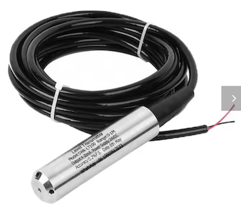
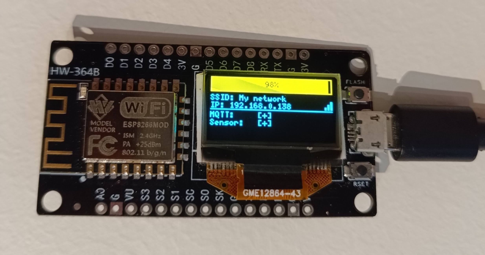
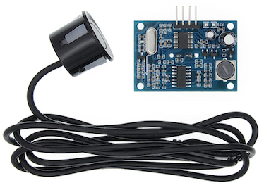
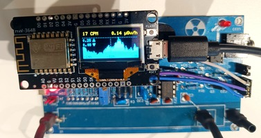
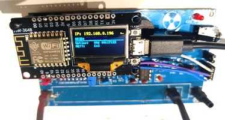
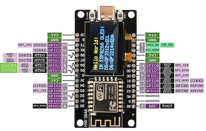
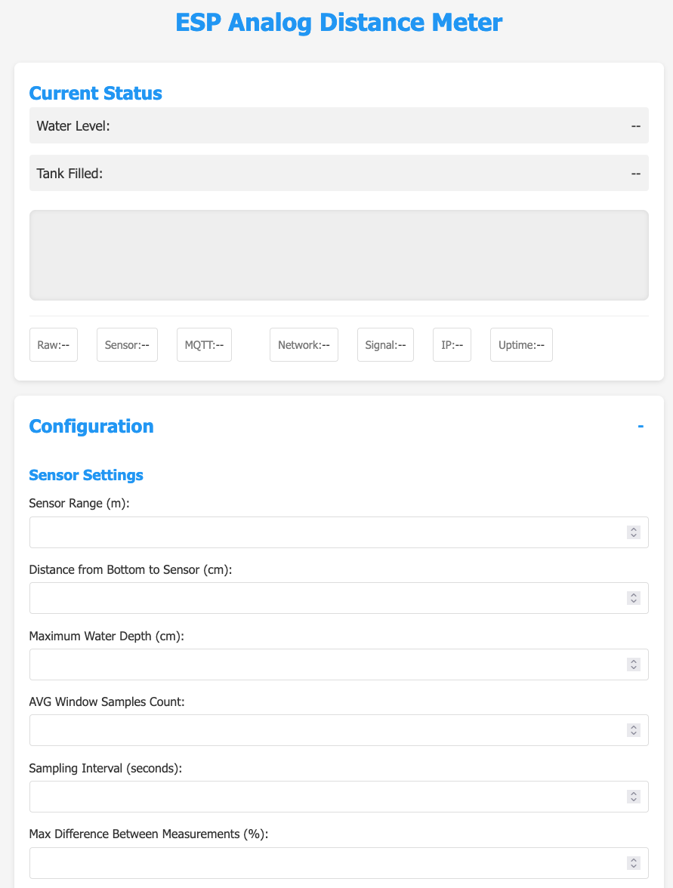
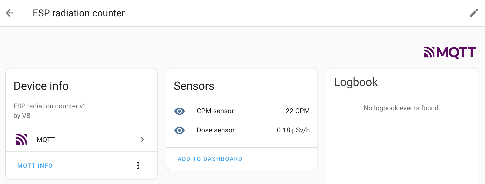

# ESP Unified

A unified ESP8266 / ESP32-C6 firmware that combines three sensor projects into a single codebase with a runtime-selectable plugin system.

## Targets

| Environment | Hardware | Notes |
|---|---|---|
| `nodemcu` / `nodemcu_ota` | NodeMCU ESP8266 with sensors wired as described below | original target |
| `xiao_c6` / `xiao_c6_ota` | ESP Measurement Platform v1 (`hardware/releases/v1`, Seeed XIAO ESP32-C6) | built with the pioarduino platform (Arduino-ESP32 3.x); `-DBOARD_XIAO_ESP32C6` selects `lib/Core/Board.h` |

On the v1 board:

- **Analog Distance (4–20 mA):** probe on `J2.3 (+24V)` / `J2.4`; the firmware reads the calibrated millivolts across the on-board 120 Ω shunt (`analogReadMilliVolts`), so 4 mA = 0.48 V and 20 mA = 2.40 V. Readings below 3.6 mA count as a sensor fault (NAMUR NE43).
- **Ultrasonic Distance:** `TRIG` → `J2.7 (IO2)`, `ECHO` → `J2.6 (IO1)`.
- **Radiation Counter:** pulse → `J2.6 (IO1)`.
- **Pressure / 0–10 V:** sensor output → `J2.5 (0-10V)` (22k/10k divider, 0–10 V usable).
- **Display:** 0.96" SSD1312 OLED, 64×128 portrait (U8g2 `SSD1312_128X64_NONAME`, rotated `U8G2_R1`; set `DISPLAY_ROTATION` to 3 in `Display.cpp` if the image is upside down). Four pages, laid out as in `mechanical/scripts/oled_page1_bitmap.py`:
  1. Main reading: big value, 56-point trend with dotted MIN/MAX lines, two secondary values, MQTT/sensor ticks, IP.
  2. STAT: raw reading, terminal signal (mA / V / pulses), 24 h low/high, relay state and switch-on count, free heap, error count, uptime.
  3. LOG: the last 8 device events (boot, WiFi/MQTT up/down, sensor fault, limit alarms, relay switching).
  4. WIFI: connection state and how to open the setup portal.
  - A limit alarm pops up an alert screen until PAGE is pressed (or *Dismiss* in the web UI).
- **Buttons** (one ADC ladder):
  - PAGE cycles the pages, or dismisses a pending alert.
  - Tapping RST/WIFI reboots.
  - Holding RST/WIFI for 5 s reboots into the WiFi setup portal (saved settings are kept); holding it 5 s again in the portal leaves it.
  - Holding RST/WIFI for 15 s does a factory reset.
- **LEDs:**
  - STATUS shows a heartbeat.
  - NET shows the connection state: green = MQTT, amber = WiFi only, blinking blue = setup portal, blinking red = offline.
  - SENS flashes on every sample.
- **Relay (`J4`: COM / NO / NC, 230 VAC ≤ 2 A):**
  - Off at boot.
  - Home Assistant discovers it as a **Relay** switch.
  - MQTT command topic: `<device_name>/relay/set` (`ON` / `OFF`).
  - State topic: `<device_name>/relay`.
  - It can also be switched from the web UI, or driven by the MIN/MAX limits (see below).

### Limits, alerts and relay rule

*Configuration → Limits & Relay* sets a MIN and/or MAX limit in the unit of the main reading (% for tanks, the configured unit for pressure, µSv/h for radiation), a hysteresis, and the relay rule:

- `manual`: MQTT and the web UI switch the relay.
- `on_alarm` / `off_alarm`: the relay follows the alarm, and manual commands are refused. A sensor fault holds the last relay state.

The settings apply when saved, with no restart needed.

### Web UI

The web UI is built per sensor type, following the high-performance HMI guidelines (ISA-101): neutral greys, one colour for live data, amber/red only for abnormal states (always with text and an icon), and every measurement shown against its normal and alert range.

- **Overview** answers one question first, depending on the sensor:
  - **Tank:** level, volume and flow, plus a forecast of when the tank reaches the alert level (or empty/full), from 24 h use or the level trend.
  - **Pressure:** a moving analog scale with the alert band and the 24 h range.
  - **Radiation:** dose rate on a log scale with the published bands (< 0.20 µSv/h normal background, 0.20–10 elevated, > 10 high, as used by Aranet), the 5-min average, the counting precision, and the annual dose at the current rate.
- **Alerts** state what is wrong, what the relay did and what to check, and can be acknowledged.
- **Staleness and faults:** stale data is flagged with its age; a sensor fault shows "—" and a wiring hint, never a plausible-looking zero.
- **History:** the last 24 h stored on the device (15 min averages; radiation: graph bars) and all events since boot.
- **Settings:** grouped forms with units on the limit inputs. Limits and the relay rule apply immediately; sensor and MQTT changes offer a restart.
- **Device:** status, firmware upload, system log, restart and factory reset.

API additions (`GET /api/v1/status` and the WebSocket `stats_update` carry the same fields):

- `screen` (with `kind`: level / pressure / radiation / voltage), `limits`, `relay`, `events`, `display`, `errors`, `warnings` and `uptime_s` in the status; every `stats[]` entry has a stable `key`.
- `GET /api/v1/chart`: 24 h history for every sensor, with `points`, `span_seconds` and `unit`.
- `POST /api/v1/relay?state=on|off` returns 409 while a limit rule owns the relay.
- `POST /api/v1/display?action=page|dismiss`.

Build both targets on any host with Docker (CI-equivalent; PlatformIO Core pinned to 6.1.19: 6.2.0 breaks the ESP8266 build):

```bash
docker build -f Dockerfile.firmware -t esp-firmware .
docker run --rm -v "$PWD":/project -v esp-pio:/root/.platformio esp-firmware \
  "pio run -e xiao_c6 && pio run -e nodemcu"
```

## Supported Plugins

### Analog Distance Meter (`analog_distance`)




Measures distance using a 4-20mA analog sensor (e.g. SWK-LT100) connected to the `A0` pin. Calculates relative fill percentage and absolute depth (water, other liquids, or bulk solids such as salt). Publishes `relative`, `absolute`, and `measured` values to MQTT.

**Wiring:** Sensor output → 4-20mA to 0-3.3V converter → `A0`

The converter circuit uses a 160Ω precision resistor (V = I × R → 4mA = 0.64V, 20mA = 3.2V). Optionally add a 10nF capacitor for noise filtering and a 3.6V Zener diode for overvoltage protection.

```
4-20mA Sensor Loop
     |   |
    (-) (+) ----+---------+--------+-------> A0
     |          |         |        |
     |         160Ω     10nF    3.6V Zener
     |          |         |        |
    (-) (+) ----+---------+--------+-------> GND
```

### Ultrasonic Distance Meter (`ultrasonic_distance`)




Measures distance using an HC-SR04 / JSN-SR04T ultrasonic sensor. Calculates relative fill percentage and absolute depth. Publishes `relative`, `absolute`, and `measured` values to MQTT.

**Wiring:** `TRIG` → `D1`, `ECHO` → `D2`, 5V from `VU` pin, `GND` to any `G` pin.

### Radiation Counter Gateway (`radiation_counter`)




Bridges Geiger-Müller tube detectors (GGreg20_V3, RadiationD-v1.1 / CAJOE, etc.) to MQTT. Calculates CPM and dose rate (µSv/h). Two-page OLED display with graph and info, toggled by the `FLASH` button.

**Wiring:** Detector signal → `D2`. ESP8266 provides 3.3V (`3V` pin) or 5V (`VU` pin) to the detector board.

**Parameters:**
- `Geiger tube` — picks the tube and fills in its factor and dead time: J305, M4011, SBM-20, STS-5, SI-29BG, SBM-19, LND 712, SI-3BG, or custom. Both values stay editable, and the web UI shows when they differ from the tube's preset. The presets are the most widely used community values (sources in `RadiationCounterPlugin.cpp`); published factors vary by ±20 % between batches, so calibrate against a reference instrument when accuracy matters.
- `Tube Factor` — CPM to µSv/h conversion (J305: 123.1, SBM-20: 175.4).
- `Tube Dead Time` — GM tube dead time in µs for saturation correction at high count rates (paralyzable model `m = n / (1 - n·τ)`). J305: 180, SBM-20: 190, `0` disables.
- `Alert Threshold` — when the 5-minute average dose reaches this µSv/h, the device exposes an `alert` flag (HA binary sensor `Elevated Radiation`).
- `Graph Bar Seconds` — seconds per graph bar on OLED. 665s ≈ 11min gives ~24h history.

### Pressure / 0-10 V Sensor (`analog_voltage`)

Linear voltage-output sensors on the 0–10 V input: 0.5–4.5 V pressure transducers (default: 0–10 bar), 0–5 V and 0–10 V sensors. Set the sensor's output voltage at min/max, the matching values, the unit and a 4-character display title. Live-zero sensors (min ≥ 0.3 V) report a fault when the input drops to ~0 V (open wire), and any sensor reports one when the input is more than 10 % over range. MQTT payload: `{ "value": 3.4, "voltage": 1.86, "connected": true }`. Home Assistant gets a pressure sensor (for pressure units), a voltage diagnostic and connectivity.

On the NodeMCU, `A0` is used (0–3.3 V); add a divider for 5/10 V sensors.

## Required Components



- NodeMCU ESP8266 Development Board (recommend the variant with built-in 0.96" OLED)
- A sensor appropriate for the chosen plugin
- Optional: external 128x64 OLED display — `D5` as `SCL`, `D6` as `SDA`

## Setup

1. Flash the firmware (see below). The web UI is compiled into it.
2. On first boot, `WiFiManager` creates an AP named `ESP_<ChipID>`. Connect to it and configure your WiFi network. The device restarts automatically.
3. Navigate to the device's IP address (shown on the OLED and Serial) to open the admin dashboard.
4. Optionally set a **Name** under *Device* — this is what Home Assistant
   shows. Left empty, the plugin's own name is used (e.g. "ESP Analog Distance
   Meter").
5. Select the active plugin, configure sensor and MQTT parameters, then **Save & Restart**.



HomeAssistant autodiscovery is published automatically — the device should appear under the MQTT integration.



### MQTT Topics

Everything the device publishes lives under a single root topic — the
configured device name:

```
<device_name>/stat/<plugin_id>   measurements (state topic, overridable)
<device_name>/diag               diagnostics (heap, RSSI, uptime)
<device_name>/availability       LWT: "online" / "offline"
```

Payload examples:

**Distance meters:**
```json
{ "relative": 0.73, "absolute": 1.12, "measured": 1.51,
  "raw": 1.55, "connected": true,
  "volume": 2340, "flow_rate": 0.42, "usage_24h": 187.3 }
```
(`volume`, `flow_rate` and `usage_24h` only when `Total Volume` is configured.)

**Radiation counter:**
```json
{ "cpm": 42, "dose": 0.34, "dose_avg_5m": 0.29, "counts_total": 183412, "alert": false }
```

Every plugin serves its history at `GET /api/v1/chart` (24 h; the radiation
counter uses its graph bars), shown on the web UI's History tab.

**Diagnostics** (all plugins), topic: `<device_name>/diag`, published every 30 s:
```json
{ "state": "active", "heap": 41520, "rssi": -62, "uptime_s": 3602, "version": "v2026.09.03.2214" }
```
HomeAssistant gets diagnostic sensors for heap, RSSI and uptime from this topic
automatically. The firmware version is exposed as the HA device's `sw_version`.

## IDE Setup

For clangd-based code intelligence (autocompletion, error checking), run the setup script after cloning:

```bash
./setup-ide.sh
```

This generates `compile_commands.json` and `.clangd` with the correct toolchain paths for your machine. Restart the clangd language server afterwards. Re-run after changing `platformio.ini` dependencies.

## Testing

Native unit tests run on the host machine using GoogleTest. They cover calculators, logger, and plugin registry — no hardware required.

### Via Docker (recommended)

```bash
docker build -f Dockerfile.test -t esp-tests .
docker run --rm esp-tests
```

### Via PlatformIO CLI

Requires `g++` on PATH:

```bash
pio test -e native -v
```

### CI

Tests run automatically on every push/PR via GitHub Actions (see `.github/workflows/ci.yml`).

## Building & Flashing

Requires [PlatformIO](https://platformio.org/).

### Via USB

```bash
# Build
pio run -e nodemcu

# Flash firmware (includes the web UI)
pio run -t upload -e nodemcu
```

The web UI in `data/` is gzipped into `lib/WebApi/WebAssets.h` by
`tools/embed_web.py` before every build (about 23 KB of flash), so one
`firmware.bin` updates firmware and UI together and they can't get out of step.
Edit the files in `data/`; the header is generated and git-ignored.

### Via the web interface (recommended for updates)

Build the image locally, then upload it from the device's web UI
(**Device → Firmware update**). Uploads go over plain HTTP, so they do not need
the contiguous heap a TLS download would require.

```bash
# Firmware + web UI -> .pio/build/nodemcu/firmware.bin
pio run -e nodemcu
```

Choose the `.bin` and press **Install**. The device restarts when the upload
completes.

Release builds are also attached to every GitHub release by
`.github/workflows/release.yml`, so they can be downloaded and uploaded the
same way.

### Via OTA (espota)

Replace `<DEVICE_IP>` with the device's IP address. Note this needs a
contiguous 4 KB heap block for `Update.begin()`, which is not always available
while the web server and MQTT are running:

```bash
pio run -t upload -e nodemcu_ota --upload-port <DEVICE_IP>
```
