# ESP Measurement Platform

A 1-DIN rail sensor node and its firmware: tank level (4–20 mA or ultrasonic), pressure or any 0–10 V sensor, and Geiger-counter radiation, with an OLED, a local web UI, a 230 V relay driven by alert limits, and Home Assistant auto-discovery over MQTT.

<p align="center">
  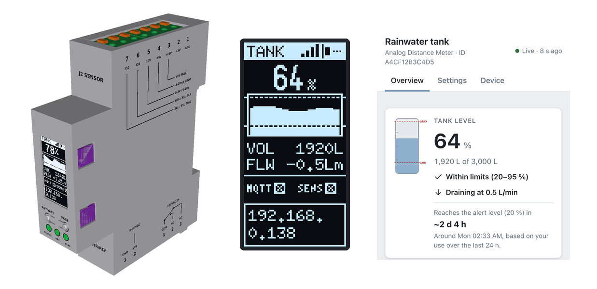
</p>
<p align="center"><sub>Rendered from the sources: enclosure CAD, the firmware's own OLED drawing code and the web UI (<a href="#regenerating-the-images">how</a>).</sub></p>

> **Status:** hardware v1 is designed and passes DRC, footprint and fit checks, but no board has been built or tested yet. The firmware builds for both targets and its unit tests pass in CI.

**Contents:** [Hardware](#hardware-v1) · [Screens](#screens) · [Sensors](#sensors) · [Alerts and relay](#alerts-and-relay) · [Setup](#setup) · [Home Assistant and MQTT](#home-assistant-and-mqtt) · [Build, flash, test](#build-flash-test)

## Hardware (v1)

<p align="center">
  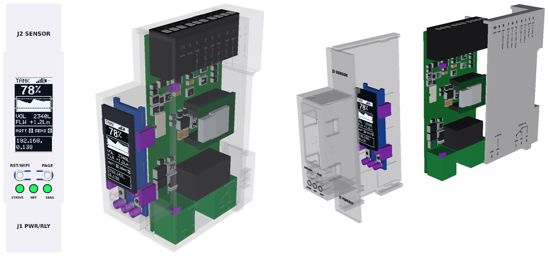
</p>

| | |
|---|---|
| **Enclosure** | 1 DIN module (18 mm) printed clamshell, or a wall-mount box with the display on its face; terminals on top (sensors) and bottom (power, relay) |
| **Controller** | Seeed XIAO ESP32-C6 on sockets, 4-layer main + UI boards (one breakaway panel) |
| **Power** | 9–30 V DC (24 V nominal), reverse and surge protected, 5 V / 600 mA buck |
| **Inputs** | 4–20 mA (120 Ω shunt, 50 mA fuse), 0–10 V, two protected digital/bus lines (I²C, UART, pulses), +24 V / +5 V sensor supply |
| **Output** | Relay, COM / NO / NC, 230 VAC up to 2 A, off at power-up |
| **Front** | 0.96" 64×128 OLED, PAGE and RST/WIFI buttons, STATUS / NET / SENS LEDs |

Full design, BOM, ordering files, wiring examples, mains-safety notes and open items: **[hardware/releases/v1](hardware/releases/v1/README.md)**.

<details>
<summary><b>Wall-mount box (non-DIN)</b></summary>

<p align="center">
  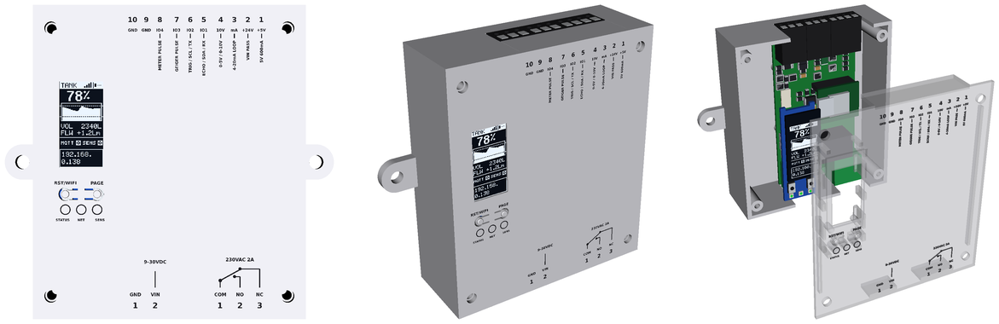
</p>

The same boards in a 26 × 81 × 70 mm box with screw ears: the main board drops into a tray, the UI board is turned to face the lid beside the terminal legend, and the lid is held by four M3 screws. Files and assembly: [box_enclosure](hardware/releases/v1/box_enclosure) and the [release notes](hardware/releases/v1/README.md).
</details>

<details>
<summary><b>PCBs and accessories</b></summary>

<p align="center">
  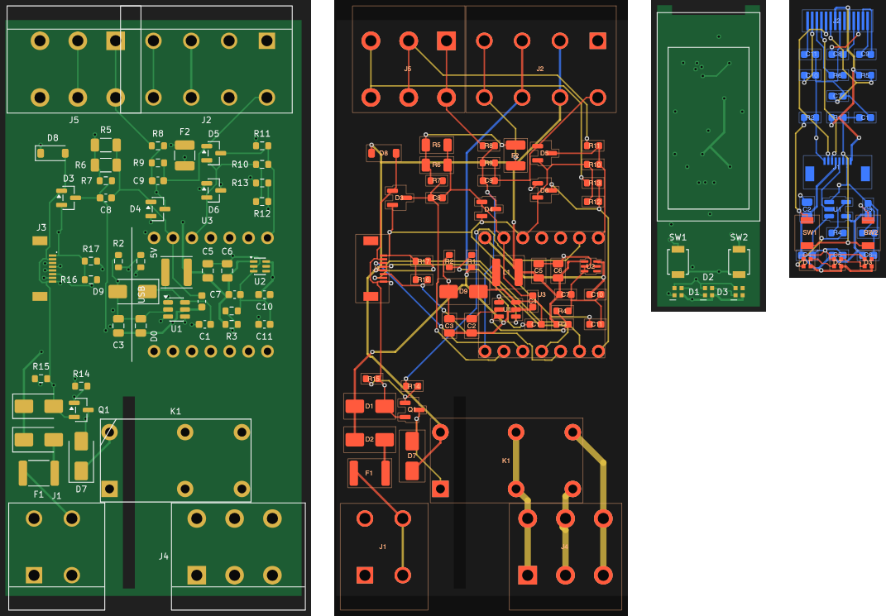
  <br><sub>Main board (top, copper) and UI board (top, copper), same scale.</sub>
</p>
<p align="center">
  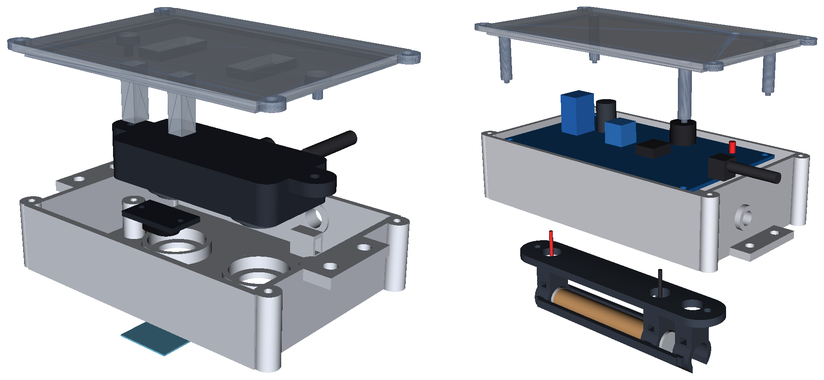
  <br><sub>Printable accessories: lid-mount distance sensor pod and the radiation counter duct mount.</sub>
</p>
</details>

<details>
<summary><b>Buttons and LEDs</b></summary>

- **PAGE:** cycles the OLED pages, or acknowledges a pending alert.
- **RST/WIFI:** tap to reboot; hold 5 s to reboot into the WiFi setup portal (settings are kept; hold 5 s again to leave it); hold 15 s for a factory reset.
- **STATUS** heartbeat · **NET** green = MQTT, amber = WiFi only, blinking blue = setup portal, blinking red = offline · **SENS** flashes on every sample.
</details>

## Screens

### OLED

<p align="center">
  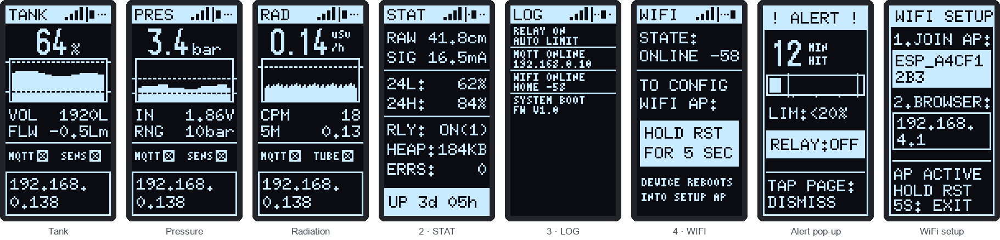
</p>

Page 1 shows the main reading with a 56-point trend and the alert limits as dotted lines. **STAT** has the raw reading, terminal signal, 24 h low/high, relay, memory and errors; **LOG** the last device events; **WIFI** how to reach the setup portal. An alert pops up until PAGE is pressed. If the first board shows the image upside down, set `DISPLAY_ROTATION` to 3 in `lib/Display/Display.cpp`.

### Web UI

Served by the device itself and built per sensor type, following the high-performance HMI guidelines (ISA-101): neutral greys, colour only for abnormal states, and every value shown against its normal and alert range.

| Tank | Pressure | Radiation, alert active |
|:---:|:---:|:---:|
| 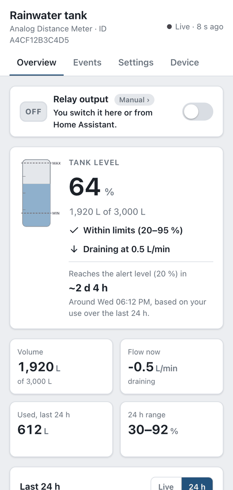 | 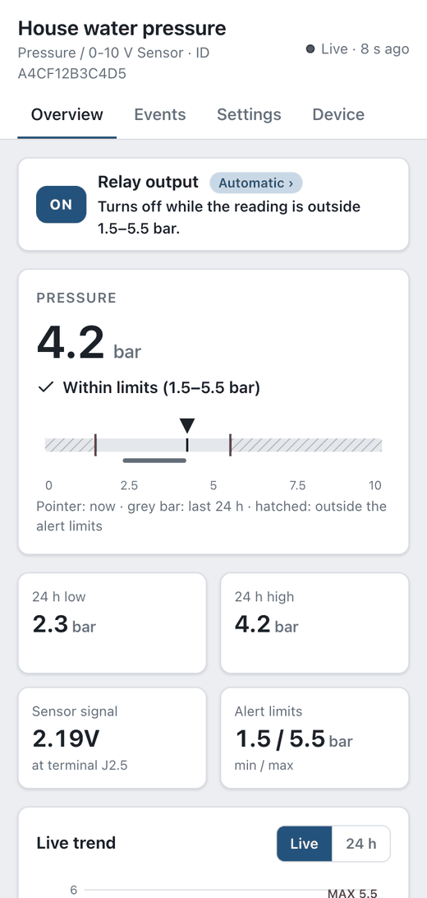 | 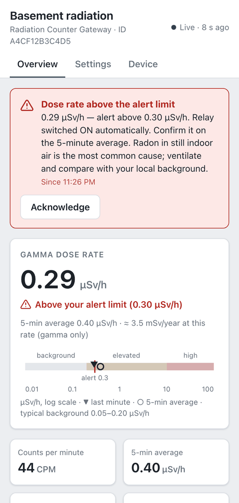 |
| Forecast of when the tank reaches the alert level, from the last 24 h of use | Moving scale with the alert band and the 24 h range | Alert with acknowledge; dose on a log scale with published bands |

<details>
<summary><b>Desktop layout and settings</b></summary>

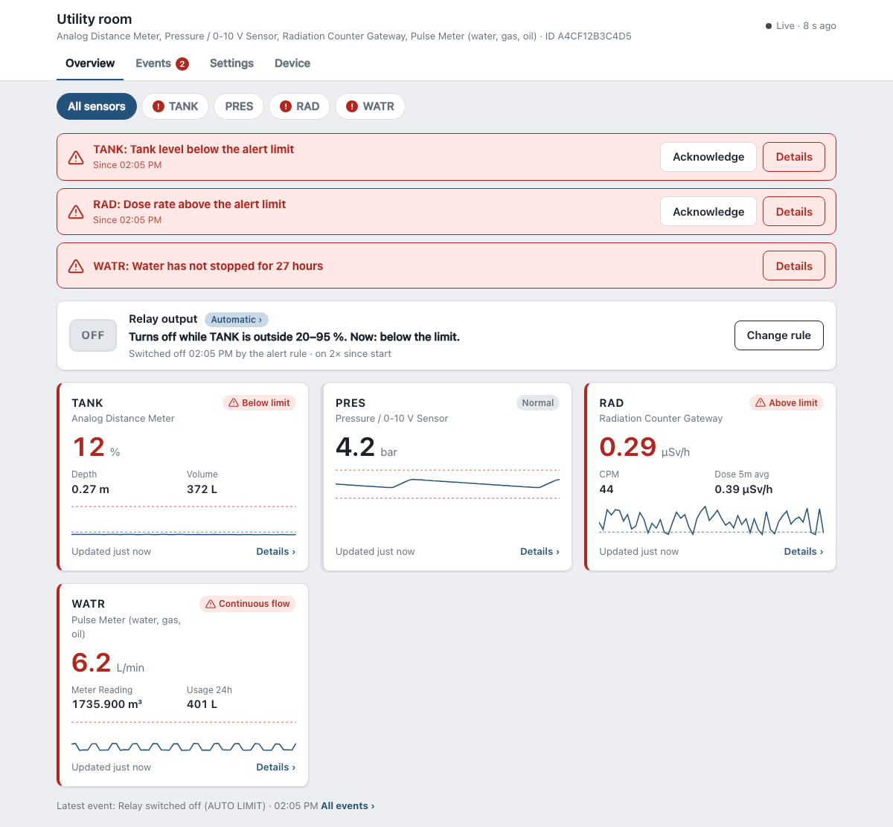

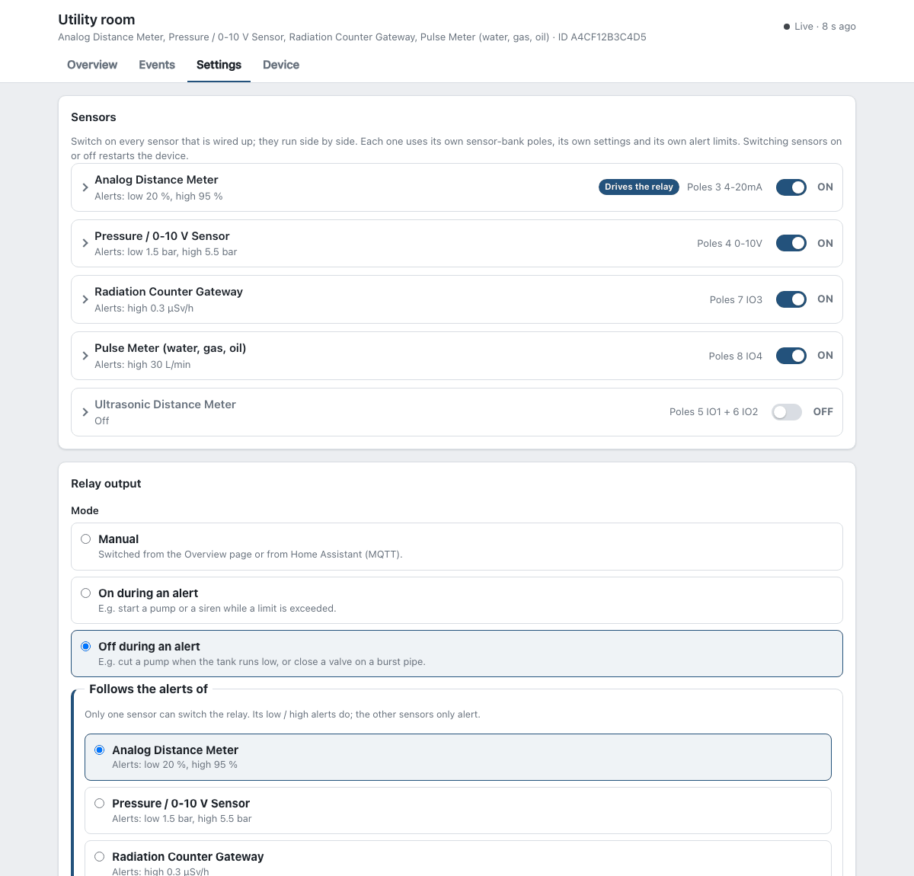

- **Overview:** headline reading, live or 24 h chart with lowest/average/highest, relay control, events.
- **Settings:** sensor type and parameters (e.g. a Geiger tube list that fills in known values), explicit ON/OFF switches per alert, relay rule, device name and MQTT. Alert and relay changes apply immediately; sensor and MQTT changes offer a restart.
- **Device:** status, firmware upload, system log, restart and factory reset.
- Stale data shows its age, and a sensor fault shows "—" with a wiring hint instead of a believable zero.
</details>

<details>
<summary><b>HTTP API</b></summary>

- `GET /api/v1/status` (also pushed as the WebSocket `stats_update` event): `screen` (with `kind`: level / pressure / radiation / voltage), `stats[]` (`{key, label, value, numeric}`), `limits`, `relay`, `events`, `configured`, `errors`, `warnings`, `uptime_s`.
- `GET /api/v1/chart`: 24 h history (`points`, `span_seconds`, `unit`).
- `GET` / `POST /api/v1/config`, `GET /api/v1/plugins`.
- `POST /api/v1/relay?state=on|off` (409 while an alert rule controls the relay), `POST /api/v1/alert/ack`, `POST /api/v1/restart`, `POST /api/v1/reset`, `POST /api/v1/upload` (firmware).
</details>

## Sensors

Pick the sensor in the web UI (**Settings → Sensor**); one is active at a time.

| Plugin | Sensors | v1 terminals | Main reading |
|---|---|---|---|
| `analog_distance` | 2-wire 4–20 mA level probes (e.g. SWK-LT100) | `J2.3 +24V`, `J2.4 4-20mA` | Fill %, depth, volume and flow |
| `ultrasonic_distance` | HC-SR04 / JSN-SR04T | `J2.7 IO2` = TRIG, `J2.6 IO1` = ECHO | Fill %, depth |
| `analog_voltage` | 0.5–4.5 V pressure transducers, 0–5 V, 0–10 V | `J2.5 0-10V` | Pressure (or any unit) |
| `radiation_counter` | GM tube boards (CAJOE RadiationD-v1.1, GGreg20_V3) | `J2.6 IO1` = pulse | Dose rate µSv/h, CPM |

<details>
<summary><b>Distance meters</b></summary>

- **4–20 mA:** the firmware reads the calibrated voltage across the on-board 120 Ω shunt (4 mA = 0.48 V, 20 mA = 2.40 V). Below 3.6 mA counts as a sensor fault (NAMUR NE43).
- Works for water, other liquids and bulk solids such as salt. Set the empty and full readings; set **Total Volume** to get volume, flow rate and 24 h usage.
</details>

<details>
<summary><b>Pressure / 0–10 V</b></summary>

Set the sensor's output voltage at min and max, the matching values, the unit and a 4-character display title (defaults: 0.5–4.5 V = 0–10 bar). Live-zero sensors (min ≥ 0.3 V) report a fault when the input drops to about 0 V (open wire); any sensor reports one more than 10 % over range. Home Assistant gets a pressure sensor (for pressure units), a voltage diagnostic and connectivity.
</details>

<details>
<summary><b>Radiation counter</b></summary>

- **Geiger tube:** J305, M4011, SBM-20, STS-5, SI-29BG, SBM-19, LND 712, SI-3BG or custom. Picking one fills in its **Tube Factor** (CPM per µSv/h; J305 123.1, SBM-20 175.4) and **Tube Dead Time** (µs, saturation correction `m = n / (1 - n·τ)`; 0 = off). Both stay editable and the UI shows when they differ from the preset. Published factors vary by ±20 % between batches (sources in `RadiationCounterPlugin.cpp`); calibrate against a reference instrument when accuracy matters.
- **Alert Threshold:** 5-minute average dose that raises the `alert` flag (HA binary sensor *Elevated Radiation*).
- A glass tube measures ambient gamma, not radon in the air stream.
</details>

## Alerts and relay

**Settings → Alerts** has a low and a high alert, each with an ON/OFF switch and a value in the unit of the main reading (% for tanks, the sensor unit for pressure, µSv/h for radiation), plus a clear margin (hysteresis). The relay is either **manual** (web UI, MQTT, Home Assistant) or follows the alert (**on** or **off during an alert**, e.g. a siren or dry-run protection). While a rule owns the relay, manual commands are refused, and a sensor fault holds the last state. Changes apply without a restart.

## Setup

1. Flash the firmware (it includes the web UI), see [Build, flash, test](#build-flash-test).
2. On first boot the device opens a WiFi access point `ESP_<ChipID>` (the OLED shows the name). Join it and enter your WiFi; the device restarts.
3. Open the device's IP address (shown on the OLED) and choose the sensor, its settings and the MQTT broker in **Settings**. An optional **Display name** is what Home Assistant shows.

## Home Assistant and MQTT

Home Assistant discovers the device through the MQTT integration: the plugin's sensors, heap/RSSI/uptime diagnostics and the relay switch.

<details>
<summary><b>Topics and payloads</b></summary>

```
<device_name>/stat/<plugin_id>   measurements (state topic, overridable)
<device_name>/diag               heap, RSSI, uptime, version (every 30 s)
<device_name>/availability       LWT: "online" / "offline"
<device_name>/relay              relay state ON / OFF
<device_name>/relay/set          relay command ON / OFF
```

```json
{ "relative": 0.73, "absolute": 1.12, "measured": 1.51, "raw": 1.55, "connected": true,
  "volume": 2340, "flow_rate": 0.42, "usage_24h": 187.3 }
{ "value": 3.4, "voltage": 1.86, "connected": true }
{ "cpm": 42, "dose": 0.34, "dose_avg_5m": 0.29, "counts_total": 183412, "alert": false }
{ "state": "active", "heap": 41520, "rssi": -62, "uptime_s": 3602, "version": "v2026.09.03.2214" }
```

Distance: `volume`, `flow_rate` and `usage_24h` only when **Total Volume** is set. The firmware version is the HA device's `sw_version`.
</details>

## Build, flash, test

Target: `xiao_c6` (USB) / `xiao_c6_ota` (network) for the v1 board, built with the pioarduino platform (Arduino-ESP32 3.x).

```bash
# In Docker, as CI does (PlatformIO Core pinned to 6.1.19)
docker build -f Dockerfile.firmware -t esp-firmware .
docker run --rm -v "$PWD":/project -v esp-pio:/root/.platformio esp-firmware "pio run -e xiao_c6"

pio run -e xiao_c6 -t upload                                  # USB
pio run -e xiao_c6_ota -t upload --upload-port <DEVICE_IP>    # OTA (espota)
pio test -e native                                            # unit tests on the host
```

- **Release files:** every release (and every CI run, as build artifacts) has two images:
  - `firmware.bin`: for **Device → Firmware update** in the web UI; it includes the web UI (`tools/embed_web.py` gzips `data/` into it) and keeps settings. The device refuses the other file here.
  - `firmware-full-usb.bin`: bootloader, partition table and app in one file for an empty or bricked board over USB: `esptool --chip esp32c6 write-flash 0x0 <file>` or the [browser flasher](https://espressif.github.io/esptool-js/). It erases saved settings.
- **Web UI without hardware:** `python3 tools/webui_mock.py`, then open <http://127.0.0.1:8790/?sensor=tank> (scenarios: tank, tank-basic, tank-alarm, pressure, radiation, radiation-high, fault).
- **IDE:** `./setup-ide.sh` generates `compile_commands.json` and `.clangd` for clangd.
- **CI:** builds both targets and runs the tests on every push (`.github/workflows/ci.yml`); releases attach both images.
- Contributor notes (layout, conventions, checks): [AGENTS.md](AGENTS.md).

### Regenerating the images

`python3 tools/readme_images/render.py` rebuilds everything in `doc/images/`: the OLED pages from `lib/Display` through the real U8g2 code, the web UI from `data/` via the mock and headless Chrome, and crops of the hardware renders in `hardware/releases/v1`. Needs Pillow, Chrome and one prior `pio run -e xiao_c6`.
