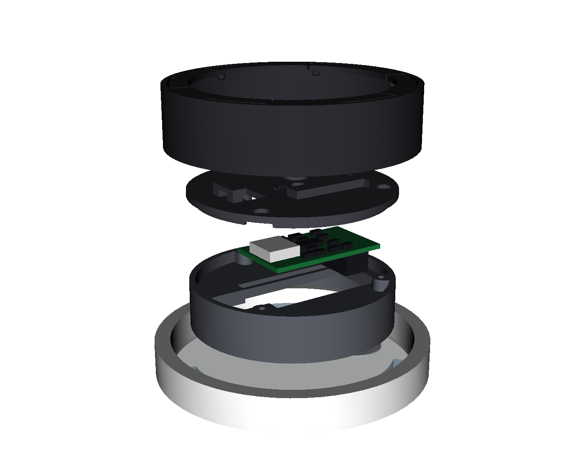
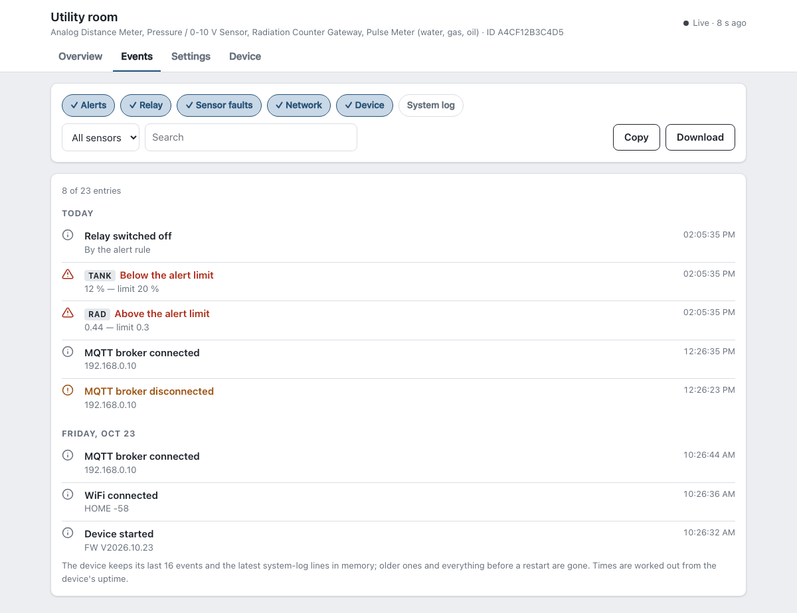

# ESP Measurement Platform

A 1-DIN rail sensor node and its firmware: tank level (4–20 mA or ultrasonic), pressure or any 0–10 V sensor, Geiger-counter radiation and pulse meters (water, gas, oil, including our optical dial reader), with an OLED, a local web UI, a 230 V relay driven by alert limits, and Home Assistant auto-discovery over MQTT.

<p align="center">
  
</p>
<p align="center"><sub>Rendered from the sources: enclosure CAD, the firmware's own OLED drawing code and the web UI (<a href="#regenerating-the-images">how</a>).</sub></p>

> **Status:** hardware v1 is designed and passes DRC, footprint and fit checks, but no board has been built or tested yet. The firmware builds and its unit tests pass in CI.

**Contents:** [Hardware](#hardware-v1) · [Screens](#screens) · [Connecting the sensors](#connecting-the-sensors) · [Alerts and relay](#alerts-and-relay) · [Setup](#setup) · [Home Assistant and MQTT](#home-assistant-and-mqtt) · [Build, flash, test](#build-flash-test)

## Hardware (v1)

<p align="center">
  
</p>

| | |
|---|---|
| **Enclosure** | 1 DIN module (18 mm) printed clamshell, or a wall-mount box with the display on its face; terminals on top (sensors) and bottom (power, relay) |
| **Controller** | Seeed XIAO ESP32-C6 on sockets, 4-layer main + UI boards (one breakaway panel) |
| **Power** | 9–30 V DC (24 V nominal), reverse and surge protected, 5 V / 600 mA buck |
| **Inputs** | 10-pole push-in sensor bank: 4–20 mA (120 Ω shunt, 50 mA fuse), 0–10 V, four protected digital lines (ultrasonic, Geiger pulses, meter pulses, I²C/UART), +24 V / +5 V sensor supply |
| **Output** | Relay, COM / NO / NC, 230 VAC up to 2 A, off at power-up |
| **Front** | 0.96" 64×128 OLED, PAGE and RST/WIFI buttons, STATUS / NET / SENS LEDs |

Full design, BOM, ordering files, wiring examples, mains-safety notes and open items: **[hardware/releases/v1](hardware/releases/v1/README.md)**.

<details>
<summary><b>Wall-mount box (non-DIN)</b></summary>

<p align="center">
  
</p>

The same boards in a 26 × 81 × 70 mm box with screw ears: the main board drops into a tray, the UI board is turned to face the lid beside the terminal legend, and the lid is held by four M3 screws. Files and assembly: [box_enclosure](hardware/releases/v1/box_enclosure) and the [release notes](hardware/releases/v1/README.md).
</details>

<details>
<summary><b>PCBs and accessories</b></summary>

<p align="center">
  
  <br><sub>Optical dial reader: carrier, board, lid and lock ring (separate PCB).</sub>
</p>

<p align="center">
  
  <br><sub>Main board (top, copper) and UI board (top, copper), same scale.</sub>
</p>
<p align="center">
  
  <br><sub>Printable accessories: lid-mount distance sensor pod and the radiation counter duct mount.</sub>
</p>
</details>

<details>
<summary><b>Buttons and LEDs</b></summary>

- **PAGE:** moves to the next sensor (then the DEV, LOG and WIFI pages), or acknowledges a pending alert.
- **RST/WIFI:** tap to reboot; hold 5 s to reboot into the WiFi setup portal (settings are kept; hold 5 s again to leave it); hold 15 s for a factory reset.
- **STATUS** heartbeat · **NET** green = MQTT, amber = WiFi only, blinking blue = setup portal, blinking red = offline · **SENS** flashes on every sample.
</details>

## Screens

### OLED

<p align="center">
  
</p>

Each running sensor has one page: its reading with a 56-point trend and its alert limits as dotted lines, two secondary values, then its own diagnostics: sensor state and terminal signal, plus two rows, the 24 h low/high, or for a pulse meter the time since the last pulse and the 24 h peak flow (its 24 h low is always 0). Device-wide information is shown once instead of on every sensor page: **DEV** has MQTT, WiFi, the relay and which sensor drives it, memory, errors, uptime and the IP; **LOG** the last device events; **WIFI** how to reach the setup portal. Every header shows the WiFi bars, an **M** while the MQTT broker is connected (gone when it is not) and the page number. An alert pops up, naming its sensor, until PAGE is pressed. If the first board shows the image upside down, set `DISPLAY_ROTATION` to 3 in `lib/Display/Display.cpp`.

### Web UI

Served by the device itself and built per sensor type, following the high-performance HMI guidelines (ISA-101): neutral greys, colour only for abnormal states, and every value shown against its normal and alert range.

| Tank | Pressure | Radiation, alert active |
|:---:|:---:|:---:|
|  |  |  |
| Forecast of when the tank reaches the alert level, from the last 24 h of use | Moving scale with the alert band and the 24 h range | Alert with acknowledge; dose on a log scale with published bands |

<details>
<summary><b>Desktop layout, settings and events</b></summary>




- **Overview:** the relay bar on top (state, the rule in words, e.g. "Turns off while TANK is outside 20–95 %", the last change; a switch in manual mode, a link to the rule in automatic mode). With one sensor, its full view below: headline reading, live or 24 h chart with lowest/average/highest. With several, sub-tabs **All sensors** + one per sensor (marked when it needs attention): *All sensors* lists every alert compactly and shows one equal card per sensor (value, state in words, two key figures, trend against its limits, freshness); a card or an alert's **Details** opens that sensor's tab with only its full view and its alerts. The tab is in the URL (`#overview/<sensor id>`).
- **Events:** device events and the system log on one timeline, newest first and grouped by day, with filters (alerts, relay, sensor faults, network, device, system log; warnings only; per sensor; search), copy and download. The tab shows a badge for alert events not yet seen.
- **Settings:** a collapsible block per sensor type (closed it shows its alert limits, or "Needs attention"), with an on/off switch showing the sensor-bank poles it needs (two sensors on one pole are refused), its parameters (e.g. a Geiger tube list that fills in known values) and its own ON/OFF alert switches; the relay rule and the sensor it follows; device name and MQTT. Alert and relay changes apply immediately; sensor and MQTT changes offer a restart.
- **Device:** status, firmware upload, restart and factory reset.
- Stale data shows its age, and a sensor fault shows "—" with a wiring hint instead of a believable zero.
</details>

<details>
<summary><b>HTTP API</b></summary>

- `GET /api/v1/status` (also pushed as the WebSocket `stats_update` event): device fields (`relay` with its `source` sensor, `events`, `configured`, `errors`, `warnings`, `uptime_s`) and `sensors[]`, one per running sensor: `id`, `name`, `configured`, `screen` (with `kind`: level / pressure / radiation / meter / voltage), `stats[]` (`{key, label, value, numeric}`), `limits`.
- `GET /api/v1/chart?sensor=<id>`: that sensor's 24 h history (`points`, `span_seconds`, `unit`); the first sensor without `sensor`.
- `GET /api/v1/config`: device settings and every sensor type with `enabled`, `inputs` (poles), `prefix`, `topic`, `params` and `limits`. `POST /api/v1/config` takes `sensors` (`"analog_distance,pulse_meter"`) and the sensors' settings under their prefix (`ad.distance_empty`, `pm.limit_high`, ...); unknown sensors or two on one input are refused with 400.
- `POST /api/v1/relay?state=on|off` (409 while an alert rule controls the relay), `POST /api/v1/alert/ack[?sensor=<id>]` (without `sensor`: every pending alert), `POST /api/v1/restart`, `POST /api/v1/reset`, `POST /api/v1/upload` (firmware).
</details>

## Connecting the sensors

Any combination of the five sensors can run at once, since each uses its own poles (they share +5V and GND; use twin ferrules where two wires share a pole). In the web UI under **Settings → Sensors**, switch on each one you have wired up, fill in its settings and save (the device restarts). Each sensor samples and publishes on its own interval.

| Terminal | Pole | Use |
|---|---|---|
| Terminal | Pole | Use |
|---|---|---|
| **J1** (bottom) | 1 GND · 2 VIN | Power in, 9–30 V DC. Use **24 V** for 4–20 mA probes. |
| **Sensor bank** (top, 3.5 mm push-in) | 1 +5V | Sensor supply, 5 V, shared 600 mA budget with the controller |
| | 2 +24V | Sensor supply: the J1 input voltage after the fuse and reverse-polarity diode (about VIN − 0.5 V) |
| | 3 4-20mA | 4–20 mA loop input (120 Ω shunt, 50 mA resettable fuse) |
| | 4 0-10V | Voltage input, 0–10 V |
| | 5 IO1 | Digital: ultrasonic ECHO |
| | 6 IO2 | Digital: ultrasonic TRIG |
| | 7 IO3 | Digital: Geiger counter pulse |
| | 8 IO4 | Digital: meter pulses (dial reader, pulse modules, reed contacts) |
| | 9, 10 GND | Sensor ground |
| **J4** (bottom) | 1 COM · 2 NO · 3 NC | Relay output, 230 VAC ≤ 2 A, fused; see [Alerts and relay](#alerts-and-relay) and the [mains notes](hardware/releases/v1/README.md) |

- **Protection:** IO1–IO4 each have a 330 Ω series resistor, clamp diodes to 3.3 V and a 4.7 kΩ pull-up, so 5 V sensor outputs and open-collector contacts connect directly.
- **Shared poles:** the sensor bank takes 0.14–1.5 mm² wire (strip 8–9 mm; press the grey button to release a wire). There is one +5V and two GND poles, so when two sensors share one, crimp both wires into a twin ferrule (2 × 0.5 mm²).
- **Pole numbers:** they're debossed on the case, as in the table.

### 1. Ultrasonic distance meter (JSN-SR04T / HC-SR04, plugin `ultrasonic_distance`)

| Sensor pin | Terminal |
|---|---|
| VCC (5V) | 1 +5V |
| GND | 9 GND |
| TRIG | 6 IO2 |
| ECHO | 5 IO1 |

- **Settings → Sensors:** switch on Ultrasonic Distance Meter.
- **Empty Distance (cm):** from the sensor face to the surface of an empty tank (the bottom, or the lowest usable level).
- **Full Distance (cm):** from the sensor face to the surface of a full tank. Keep it at least 25 cm for the JSN-SR04T: it can't measure closer than about 20–25 cm (the HC-SR04 manages about 2 cm).
- **Total Volume (L):** optional; adds volume, flow rate and 24 h usage.
- **Mounting:** point the transducer straight down, away from the walls, the inlet and any pipes, which give false short echoes. Condensation on the transducer face does the same.
- **Faults:** if no echo arrives, the UI shows a sensor fault with a wiring hint.

### 2. Analog distance meter (2-wire 4–20 mA level probe, e.g. SWK-LT100, plugin `analog_distance`)

| Probe wire | Terminal |
|---|---|
| Red (+) | 2 +24V |
| Black (−) | 3 4-20mA |
| Shield, if any | 10 GND (at the box end only) |

- **Power:** feed J1 with 24 V. At 20 mA the probe still gets about 20 V; at a 12 V supply it would get only about 8 V, below what most 2-wire transmitters need.
- **Settings → Sensors:** switch on Analog Distance Meter.
- **Sensor Range (m):** the probe's full scale, the depth at 20 mA (e.g. 5 m of water).
- **Empty Reading (cm) / Full Reading (cm):** the depth the probe reports with the tank empty and full. On site, read the probe's depth from the `measured` value (in m) on the MQTT state topic, or from the Overview's *Sensor to surface* tile while **Total Volume** is still empty.
- **Total Volume (L):** optional, as above.
- **Mounting:** hang the probe at the bottom of the tank. The probe cable has a vent tube for the atmospheric reference: don't seal or kink the cable end, and keep it dry.
- **Faults:** below 3.6 mA is a sensor fault (NAMUR NE43), e.g. a broken wire. A short to +24 V trips the 50 mA fuse, which resets about a minute after the fault is gone.

### 3. Pressure sensor, 0–5 V output (plugin `analog_voltage`)

| Sensor wire | Terminal |
|---|---|
| Supply + | 1 +5V (5 V sensors, e.g. ratiometric 0.5–4.5 V) or 2 +24V (sensors rated 9–30 V supply) |
| GND / − | 9 or 10 GND |
| Signal / output | 4 0-10V |

- **Settings → Sensors:** switch on Pressure / 0-10 V Sensor.
- **Settings for a 0–5 V sensor:** Sensor Output at Min (V) = **0**, Sensor Output at Max (V) = **5**, Value at Min = **0**, Value at Max = the sensor's range (e.g. **10**), Unit = **bar** (or psi, kPa…), Decimals and a 4-character Display Title.
- **Settings for a 0.5–4.5 V sensor (the default):** Sensor Output at Min (V) = 0.5, Sensor Output at Max (V) = 4.5.
- **Fault detection:** a 0–5 V sensor can't report a broken wire, because 0 V is a valid reading. A 0.5–4.5 V sensor can: the device reports a fault when its input drops near 0 V. Either type reports a fault when the input is more than 10 % over its range.
- **Accuracy:** a 5 V ratiometric sensor's output scales with the 5 V rail, which is regulated to ±2.5 % and not measured.

### 4. Radiation counter (CAJOE RadiationD-v1.1, plugin `radiation_counter`)

| CAJOE pin (P3 header) | Terminal |
|---|---|
| 5V | 1 +5V |
| GND | 9 or 10 GND |
| VIN (this is the pulse **output**, despite its name) | 7 IO3 |

- **Settings → Sensors:** switch on Radiation Counter Gateway.
- **Geiger tube:** pick the tube printed on the tube (CAJOE boards usually ship with a J305, some with an M4011). This fills in **Tube Factor** (CPM per µSv/h) and **Tube Dead Time**.
  - Both stay editable, and the UI shows when they differ from the preset.
  - Choices: J305, M4011, SBM-20, STS-5, SI-29BG, SBM-19, LND 712, SI-3BG or custom.
  - Published factors vary by about ±20 % between batches (sources in `RadiationCounterPlugin.cpp`), so calibrate against a reference instrument when accuracy matters.
- **Alert Threshold (uSv/h avg):** the 5-minute average that raises the alert (Home Assistant: *Elevated Radiation*).
- **Safety:** the tube runs at about 400 V. Don't touch the tube ends or the high-voltage side of the board while it's powered.
- **Wiring:** keep the pulse wire short.
- **Startup:** the first valid reading takes a minute of counting.
- **Faults:** 5 minutes without a pulse is a fault. Normal background (0.1–0.2 µSv/h) gives about 10–25 CPM on a J305.
- **What it measures:** a glass tube measures ambient gamma radiation, not radon in the air.

### 5. Pulse meter: water, gas, oil (plugin `pulse_meter`)

Counts one pulse per K litres on IO4 from any meter that gives pulses:
- **Optical dial reader:** our own add-on for a mechanical dial, described below.
- **Pulse emitter module:** for example B METERS' IWM-PL3.
- **Gas meter:** a reed contact.
- **Anything else:** any open-collector or 3.3–5 V pulse output.

Settings:
- **Settings → Sensors:** switch on Pulse Meter (water, gas, oil).
- **Medium:** Water, Gas, Oil / fuel or Other. It sets the Home Assistant device class and the entity names, so *Water Meter* or *Gas Meter* (m³, total increasing) can go straight into **Settings → Dashboards → Energy**. *Flow*, *Usage 24h* and *Continuous Flow* are separate entities.
- **Litres per Pulse (K):** the volume per pulse; for the dial reader, the volume of one wheel turn.
- **Meter Reading (m³):** the register on the dial, red pointers included (e.g. `1666.623`).
  - Saving a new value restarts the count from it; leave it unchanged afterwards.
  - The count is saved to flash at most every 10 minutes, so a power cut can lose up to 10 minutes of pulses. Compare with the dial now and then.
- **Min Pulse Gap (ms):** ignores contact noise shorter than this after a counted pulse. 50 ms is far below the pulse period even at a meter's maximum flow.
- **Leak Alert after (h):** warns when something has flowed in every single hour for that long, e.g. a dripping tap or a running cistern. 0 turns it off.
- **Alerts and relay:** the main reading is the flow in L/min, so a high alert of e.g. 30 L/min with *Off during an alert* can close a motorised valve on a burst pipe.

**Optical dial reader (our own add-on).** A reflective IR sensor watches a meter's metal half-disc or pointer through flat glass, so it needs no battery and no pre-equipped meter. It's built for a B METERS GMDM water dial but suits any dial with a reflective wheel and similar hooks.
- **Board:** [`hardware/releases/v1/reader/`](hardware/releases/v1/reader), 31.5 × 18 mm, ordered separately.
- **Housing:** [`accessories/dial_reader/`](hardware/releases/v1/accessories/dial_reader), three printed parts, 16.4 mm tall in total:
  - **Carrier:** holds the board and stands on the glass inside the hooks.
  - **Lid:** screwed onto the carrier, with a grip bar shaped like an arrow pointing at the sensor.
  - **Lock ring:** goes on last, straight down over the closed carrier, and twist-locks onto the dial's three clear hooks. Its six spring fingers press on the lid rim, but the carrier can still be turned to swing the sensor exactly over the wheel.

| Reader terminal (WAGO 2059, solid 0.14–0.34 mm²) | Sensor bank |
|---|---|
| 1 +5V | 1 +5V |
| 2 GND | 9 or 10 GND |
| 3 PULSE | 8 IO4 |

1. **Test print:** print `dial_reader_test_ring.stl` first. Set it on the glass with its tabs beside the hooks and turn it counter-clockwise until it stops; it should not lift off.
2. **Assemble:**
   - Push the board into the carrier, fit the lid with 3 × M2 × 6 self-tapping screws, and push the cable wires (stripped 4–5 mm) into the terminal through the lid's cable hole.
   - Set the carrier on the glass with the arrow towards the wheel, put the ring over it and turn the ring counter-clockwise until it stops.
3. **Point it at the wheel:** open a tap a little and watch the red LED in the ringed window on the lid (it is lit while the sensor sees the disc). Turn the carrier by its grip bar until the LED changes once per wheel turn.
4. **Trimmer (through the hole marked SET):** if the LED stays on or off whatever the carrier position, turn the trimmer until it follows the wheel. Then set it midway between the two points where it stops switching.
5. **Litres per Pulse:** set K to one wheel turn and check it by drawing a known volume (e.g. a 10 L bucket).

**Instead, a B METERS IWM-PL3 pulse module:** white wire → 8 IO4, brown → 9 or 10 GND; insulate the yellow (tamper) and green (backflow) wires. It runs on its own battery.
- **Meter:** it only fits meters pre-equipped for it, the `-I` versions (GMDM-I, GMB-RP-I, GMB-I).
- **Setup:** set its K (1–1000 L) with B METERS' *NFC IWM Config* app and enter the same K here.
- **Not usable:** the RFM-TX1 is a wireless M-Bus radio with no wired output.

## Alerts and relay

Every sensor has its own low and high alert in **Settings → Sensors**, each with an ON/OFF switch and a value in the unit of its main reading (% for tanks, the sensor unit for pressure, µSv/h for radiation, L/min for meters), plus a clear margin (hysteresis). The relay is either **manual** (web UI, MQTT, Home Assistant) or follows the alerts of one sensor chosen under **Settings → Relay output** (**on** or **off during an alert**, e.g. a siren, dry-run protection or closing a valve on a burst pipe); the other sensors only alert. While a rule owns the relay, manual commands are refused, and a sensor fault holds the last state. Changes apply without a restart.

## Setup

1. Flash the firmware (it includes the web UI), see [Build, flash, test](#build-flash-test).
2. On first boot the device opens a WiFi access point `ESP_<ChipID>` (the OLED shows the name). Join it and enter your WiFi; the device restarts.
3. Open the device's IP address (shown on the OLED) and switch on the sensors, fill in their settings and the MQTT broker in **Settings**. An optional **Display name** is what Home Assistant shows.

## Home Assistant and MQTT

Home Assistant discovers one device through the MQTT integration: the entities of every running sensor, plus the heap/RSSI/uptime diagnostics and the relay switch once for the device. Sensor entity ids start with the sensor id (`analog_distance`, `pulse_meter_total`, ...), so sensors side by side never collide.

<details>
<summary><b>Topics and payloads</b></summary>

```
<device_name>/stat/<plugin_id>   one per running sensor: its measurements, at its publish interval
<device_name>/diag               device: heap, RSSI, uptime, version (every 30 s)
<device_name>/availability       LWT: "online" / "offline"
<device_name>/relay              relay state ON / OFF
<device_name>/relay/set          relay command ON / OFF
```

```json
{ "relative": 0.73, "absolute": 1.12, "measured": 1.51, "raw": 1.55, "connected": true,
  "volume": 2340, "flow_rate": 0.42, "usage_24h": 187.3 }
{ "value": 3.4, "voltage": 1.86, "connected": true }
{ "cpm": 42, "dose": 0.34, "dose_avg_5m": 0.29, "counts_total": 183412, "alert": false }
{ "state": "active", "heap": 41520, "rssi": -62, "uptime_s": 3602, "version": "v2026.09.03.2214" }
```

Distance: `volume`, `flow_rate` and `usage_24h` only when **Total Volume** is set. The firmware version is the HA device's `sw_version`.
</details>

## Build, flash, test

Target: `xiao_c6` (USB) / `xiao_c6_ota` (network) for the v1 board, built with the pioarduino platform (Arduino-ESP32 3.x).

```bash
# In Docker, as CI does (PlatformIO Core pinned to 6.1.19)
docker build -f Dockerfile.firmware -t esp-firmware .
docker run --rm -v "$PWD":/project -v esp-pio:/root/.platformio esp-firmware "pio run -e xiao_c6"

pio run -e xiao_c6 -t upload                                  # USB
pio run -e xiao_c6_ota -t upload --upload-port <DEVICE_IP>    # OTA (espota)
pio test -e native                                            # unit tests on the host
```

- **Release files:** every release (and every CI run, as build artifacts) has two images:
  - `firmware.bin`: for **Device → Firmware update** in the web UI; it includes the web UI (`tools/embed_web.py` gzips `data/` into it) and keeps settings. The device refuses the other file here.
  - `firmware-full-usb.bin`: bootloader, partition table and app in one file for an empty or bricked board over USB: `esptool --chip esp32c6 write-flash 0x0 <file>` or the [browser flasher](https://espressif.github.io/esptool-js/). It erases saved settings.
- **Web UI without hardware:** `python3 tools/webui_mock.py`, then open <http://127.0.0.1:8790/?sensor=tank> (scenarios: tank, tank-basic, tank-alarm, pressure, radiation, radiation-high, fault).
- **IDE:** `./setup-ide.sh` generates `compile_commands.json` and `.clangd` for clangd.
- **CI:** builds both targets and runs the tests on every push (`.github/workflows/ci.yml`); releases attach both images.
- Contributor notes (layout, conventions, checks): [AGENTS.md](AGENTS.md).

### Regenerating the images

`python3 tools/readme_images/render.py` rebuilds everything in `doc/images/`: the OLED pages from `lib/Display` through the real U8g2 code, the web UI from `data/` via the mock and headless Chrome, and crops of the hardware renders in `hardware/releases/v1`. Needs Pillow, Chrome and one prior `pio run -e xiao_c6`.
