# ESP Measurement Platform Hardware v1 (1-DIN Universal Sensor Node + Plugin Enclosures)

Generated by `python3 hardware/scripts/build.py` from `hardware/circuits/variants/v1/` and `mechanical/scripts/`.
Passes KiCad DRC with **0 errors and 0 unrouted connections**, pin-for-pin JLCPCB / EasyEDA verification on all 71 SMT placements, and CadQuery 3D fit/collision checks.

| View | Render |
| :---: | :---: |
| **1-DIN Universal Sensor Node (Front, Side Legend & Exploded)** | 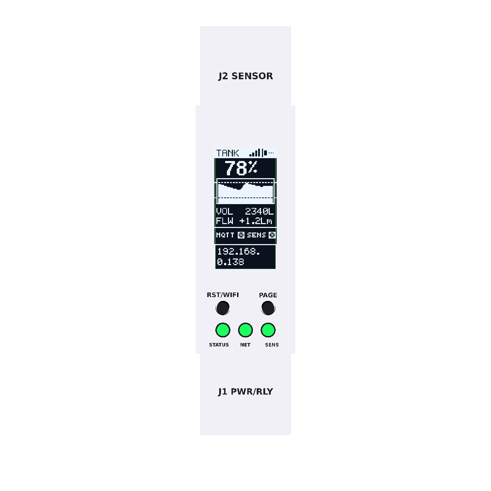 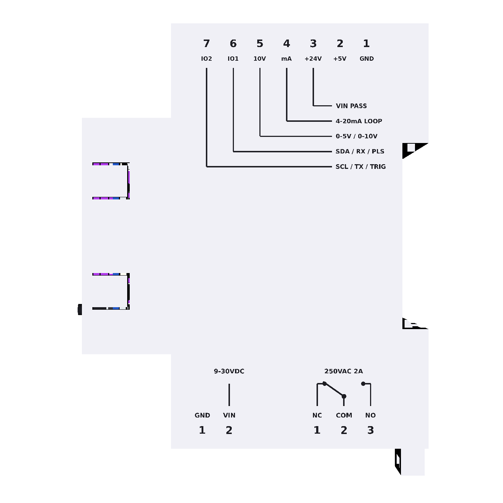 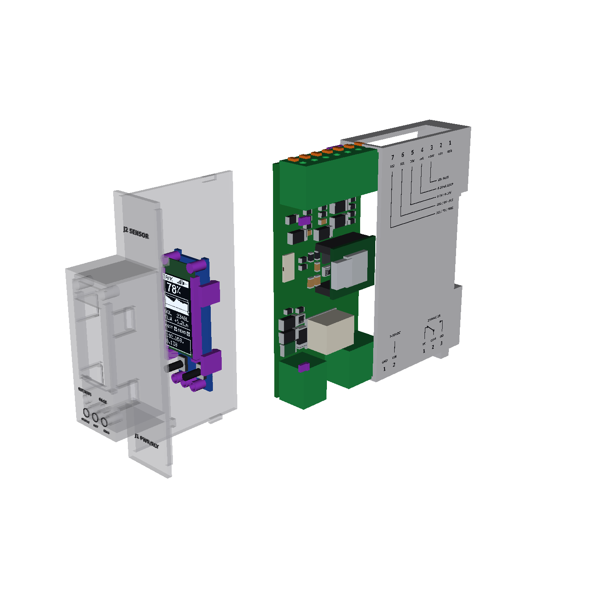 |
| **1-DIN Isometric & Internal Layout (`main` + `ui`)** | 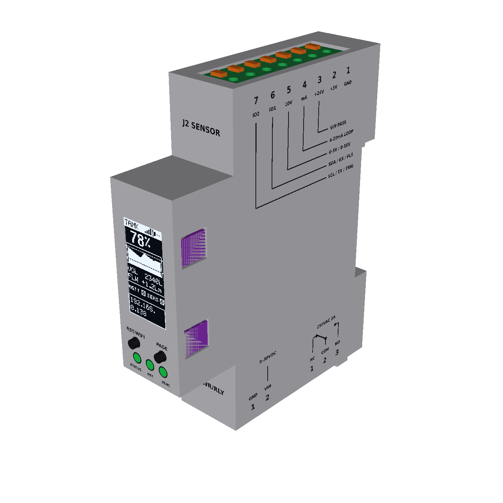 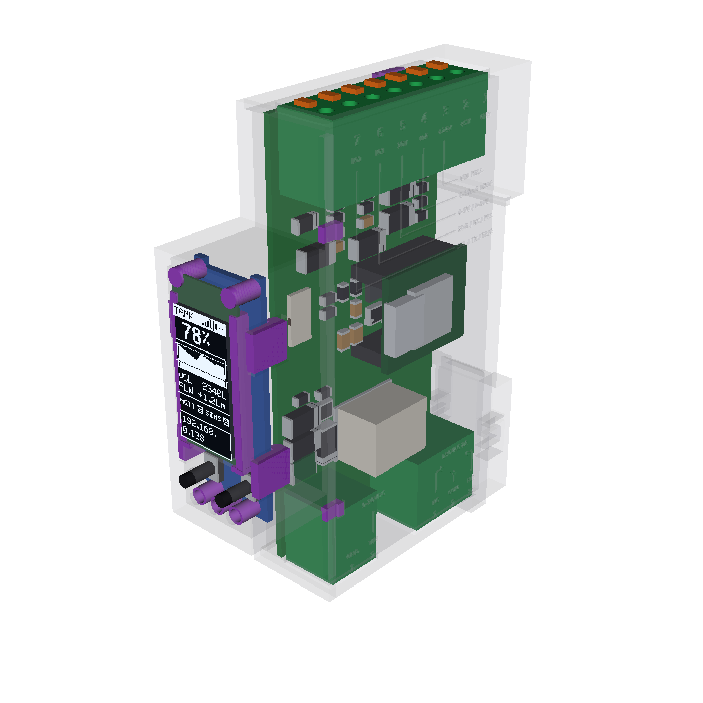 |
| **Radiation Counter Airduct Assembly (Transparent X-Ray, Cutaway & Exploded)** | 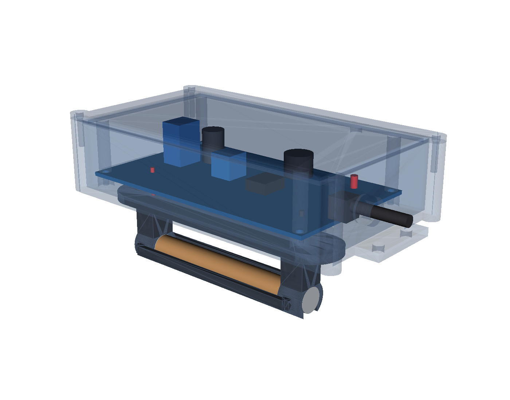 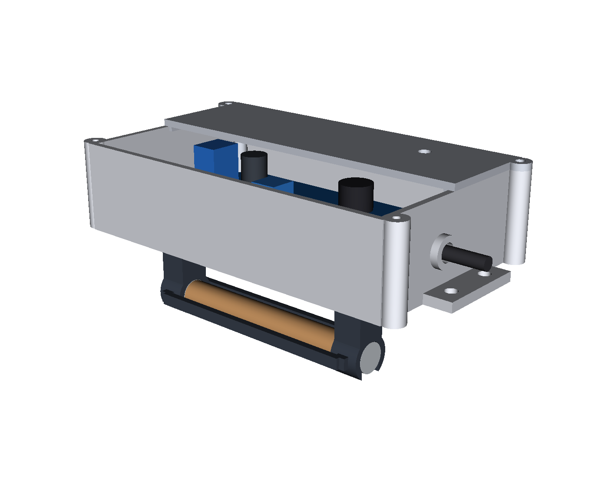 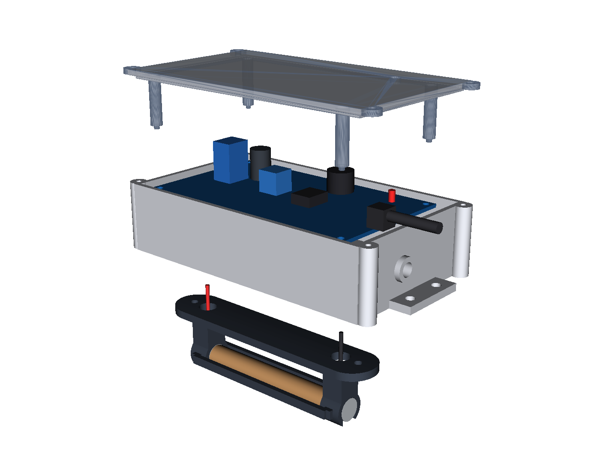 |
| **Universal Distance Sensor Pod (Transparent X-Ray, Cutaway & Exploded)** | 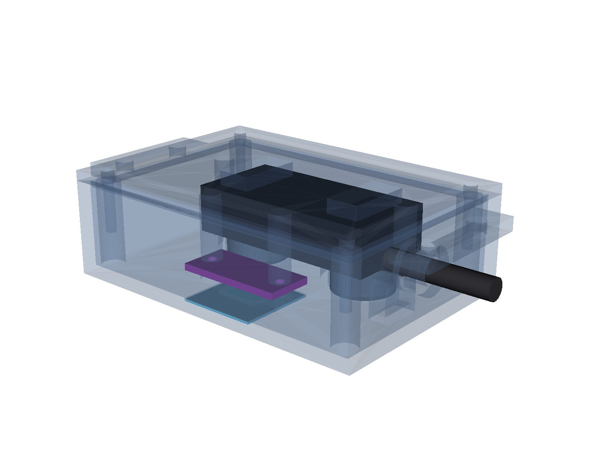 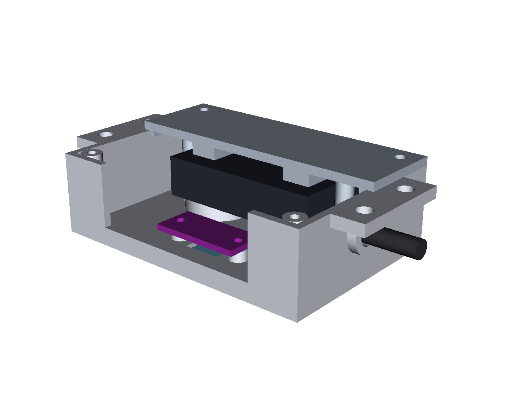 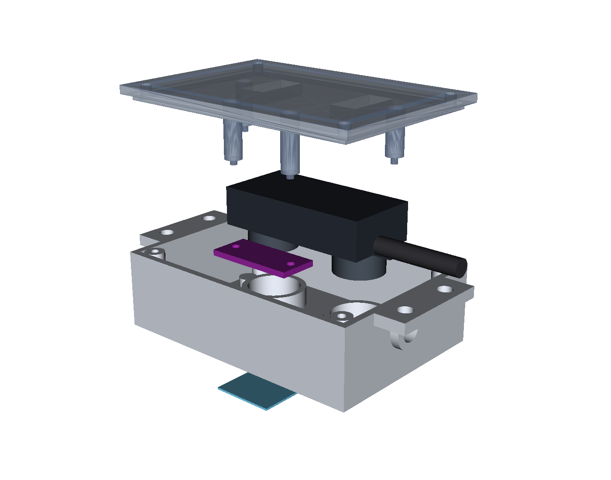 |

---

## 1. Universal 1-DIN (`18 mm`) Sensor Controller (`main` + `ui`)

| Board | Size | Layers | Thickness | Role | Folder |
|---|---|---|---|---|---|
| **Breakaway Panel (`panel`)** | **55.6 × 78.1 mm** | **4** | **1.2 mm** | **Combined `main` + `ui` with mouse-bite breakaway tabs (1 PCB + 1 PCBA order)** | **`panel/`** |
| Main (`main`) | 39.8 × 78.0 mm | 4 | 1.2 mm | Vertical PCB along the left wall: 24 V PTC/TVS/Schottky protection, `SCT2400` 24 V → 5 V (600 mA) buck converter, `LM66100` ideal diode, Seeed XIAO ESP32-C6 on 5 mm female headers, dedicated `4–20 mA` current-loop input (`165 Ω` fixed shunt, zero jumpers), dedicated `0–10 V` / `0–5 V` / `0.4–4.5 V` voltage input (`22 kΩ / 10 kΩ` divider, zero jumpers), 2 protected digital/bus channels (`IO1`, `IO2`), **Omron `G6S-2F DC5` (`250 V AC / 2 A`) SMD changeover relay (`K1`) with `6.0 mm` creepage keepout, milled PCB air slot, and `0.85 mm` parallel DPDT traces**, 7-pole top sensor terminal (`J2`), 2-pole bottom SELV power terminal (`J1`), and 3-pole bottom 250 V AC relay terminal (`J4`) | `main/` |
| UI (`ui`) | 13.8 × 40.5 mm | 4 | 1.2 mm | Snapped into the front protrusion: 0.96" `64×128` portrait SSD1312 OLED (`QG-6428TSWCG02` / `JLX12864OLED-S096W` / `NFP1312-15AY`, `14-pin 0.62 mm` solder-tail FPC `J2` directly below the `9.8 mm` top notch), two Omron `B3U-1000P` buttons (`RST/WIFI`, `PAGE`), three `SK6805-EC15` RGB LEDs (`STATUS`, `NET`, `SENS`), 8-pin 0.5 mm FFC (`J1`) to `main J3` | `ui/` |

### Terminal Pinout & Plugin Wiring

All three terminal blocks (`J1` 2-pole `KF142R-5.08-2P` `C475144`, `J4` 3-pole `KF142R-5.08-3P` `C475145`, and `J2` 7-pole `KF142R-5.08-7P` `C475149`) are JLC-assembled push-in spring terminals (`250 V / 15 A`, `0.2–1.5 mm²`):

| Terminal | Location | Poles | Protection & Function |
|---|---|---|---|
| **`J2` (`KF142R-5.08-7P`)** | Top Shoulder | **`1: GND`** · **`2: +5V`** · **`3: +24V`** · **`4: 4-20mA`** · **`5: 0-10V`** · **`6: IO1`** · **`7: IO2`** | `1: GND` (sensor ground on far side); `2: +5V` (`600 mA` out); `3: +24V` (fused loop out); `4: 4-20mA` (`D1/GPIO1/ADC1_CH1`, fixed `165 Ω` shunt + RC filter + `SS16` clamp); `5: 0-10V` (`D0/GPIO0/ADC1_CH0`, `22 kΩ / 10 kΩ` divider + `SS16` clamp for `0–5 V`, `0.4–4.5 V`, `0–10 V`, `2–10 V`); `6: IO1` (`D7/GPIO17`: `SDA / RX / PULSE`); `7: IO2` (`D6/GPIO16`: `SCL / TX`) |
| **`J1` (`KF142R-5.08-2P`)** | Bottom Front (`SELV`) | **`1: GND`** · **`2: VIN+`** | `1: GND` (power ground); `2: VIN+` (`9–30 V DC`, `1.1 A` PTC fuse + `SMAJ33A` TVS + `SS16` reverse Schottky) |
| **`J4` (`KF142R-5.08-3P`)** | Bottom Rear (`RELAY 250V AC 2A`) | **`1: NC`** · **`2: COM`** · **`3: NO`** | Separated from `J1`/`SELV` by a **`1.6 × 25.8 mm` milled air slot** and **`6.0 mm` DRC creepage barrier** (`0 mm²` of `GND` pour in the `RELAY` region). Driven by **Omron `G6S-2F DC5` (`K1`, `LCSC C16707`, `250 V AC / 2 A`)** with both DPDT contact sets wired in parallel via `0.85 mm` traces and `2.6 × 1.3 mm` pads |

1. **Analog Distance Meter (`SWK-LT100` 2-wire 4–20 mA probe):**
   - Probe `Red (+)` → **`J2.3 (+24V)`**, Probe `Black (-)` → **`J2.4 (4-20mA)`**
2. **150 PSI Water Pressure Sensor (`0.4–4.5 V` 3-wire) or `0–10 V` / `2–10 V` Sensor:**
   - Sensor `Red (+5V)` → **`J2.2 (+5V)`** (or `J2.3 +24V` for 24 V `0–10 V` sensors), Sensor `Black (GND)` → **`J2.1 (GND)`**, Sensor `Blue (Signal)` → **`J2.5 (0-10V)`**
3. **Salt-Level Distance Meter (ToF Laser `VL53L1X`/`TOF200C` I2C or Sealed Ultrasonic `A02YYUW` UART):**
   - Sensor `VCC` → **`J2.2 (+5V)`**, Sensor `GND` → **`J2.1 (GND)`**, Sensor `SDA / TX` → **`J2.6 (IO1)`**, Sensor `SCL / RX` → **`J2.7 (IO2)`**
4. **Radiation Counter (`CAJOE RadiationD-v1.1`):**
   - CAJOE `+5V` → **`J2.2 (+5V)`**, CAJOE `GND` → **`J2.1 (GND)`**, CAJOE `VIN (PULSE)` → **`J2.6 (IO1)`**

---

## 2. Printable Enclosures & Plugin Accessories

- **`enclosure/`** — 1-DIN (`18 mm`) side-opening clamshell (`base.stl`, `cover.stl`, `cover_embossed.stl`, `cover_color.3mf`, `assembly.step`).
- **`accessories/radiation_duct/`** — Airduct radiation sensor mount:
  - `cajoe_box_base.stl` & `cajoe_box_cover.stl`: Mounts on the **outside** of the ventilation duct (`120 × 68 × 22.5 mm` rectangular cavity with external corner screw bosses so the `108 × 63 × 20 mm` CAJOE board drops in with zero corner interference and `8.5 mm` of extra right-side room for the overhanging 3-pin header and jacks). Four hold-down pegs on the cover clamp the 4 corners of the CAJOE PCB onto its standoffs, and a `Ø 6.2 mm` cable gland boss on the right wall passes the 3-wire cable (`+5V`, `GND`, `PULSE`) to the 1-DIN Sensor Node.
  - `duct_tube_bracket.stl`: Curved mounting flange (`R = 185 mm` saddle contour matching the internal curvature of a `~20 cm` round airduct) that bolts onto the **inside** of the airduct wall directly into `cajoe_box_base`, suspending the bare `J305` glass tube `23 mm` into the airstream with `> 90%` open exposure.
- **`accessories/distance_sensor_pod/`** — Universal lid-mount distance sensor housing (`distance_pod_base.stl`, `distance_pod_cover.stl`):
  - Holds **both** a zero-blind-zone **ToF Laser (`VL53L1X` / `TOF200C`)** over an `18.4 × 18.4 × 0.8 mm` recessed pocket (for a standard `18 × 18 mm` `#1.5` `0.17 mm` borosilicate microscope cover slip or ST `VL53L1X` anti-crosstalk optical cap) **and/or** a **Sealed Dual-Transducer Ultrasonic (`A02YYUW`)** in twin `Ø 15.4 mm` ports.
  - Integrated hold-down pillars, locating pins, and compression ribs on the underside of `distance_pod_cover` clamp **both** the ToF laser PCB and the `A02YYUW` ultrasonic body firmly into their seats when the cover is closed, with a `Ø 6.2 mm` round cable gland port + internal zip-tie strain-relief saddle on the right wall.
