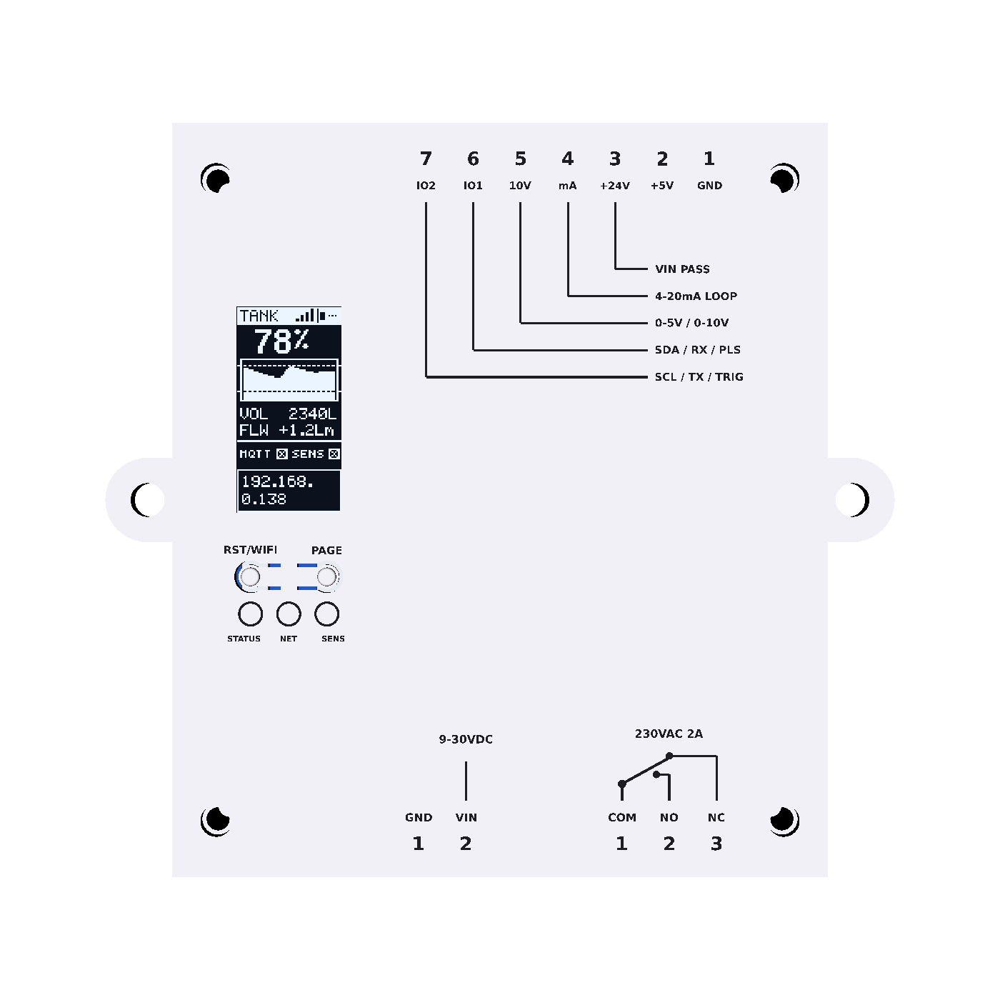
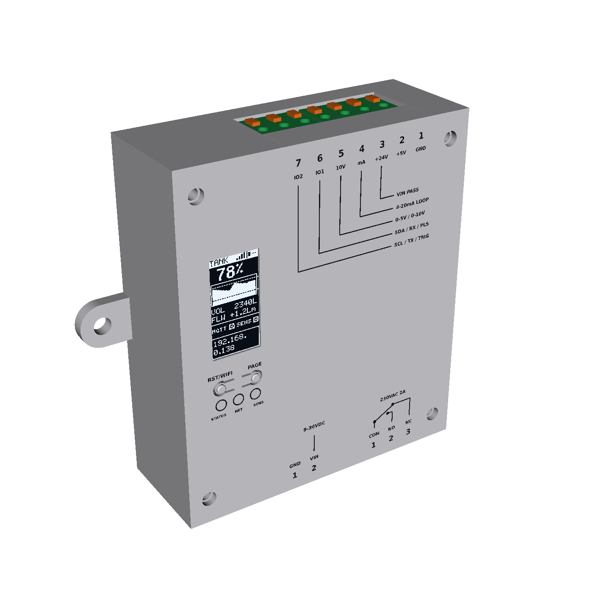
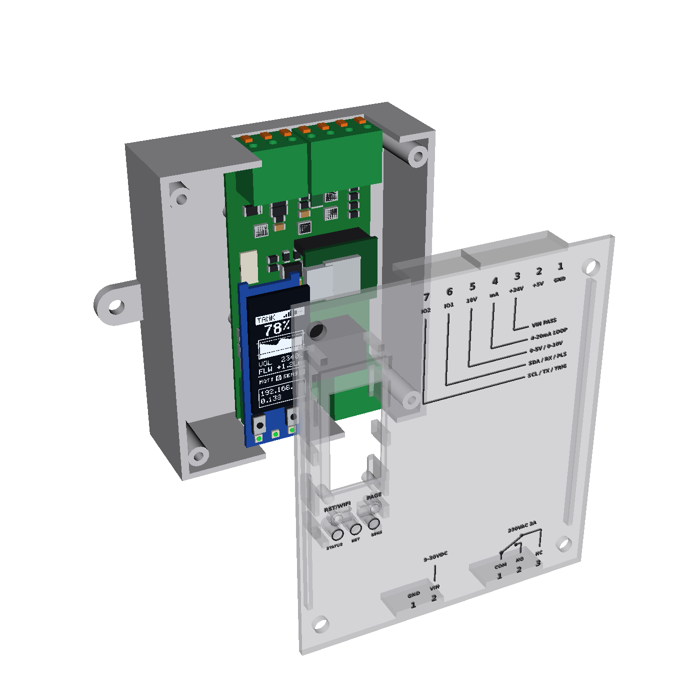

# ESP Measurement Platform Hardware v1 (1-DIN Universal Sensor Node + Plugin Enclosures)

Generated by `python3 hardware/scripts/build.py` from `hardware/circuits/variants/v1/` and `mechanical/scripts/`.
Release gate: KiCad DRC with 0 errors and 0 unrouted connections, pin-for-pin JLCPCB / EasyEDA footprint and
pin-name verification with live stock for every JLC-placed part, and the CadQuery fit tests in `mechanical/tests/`.
Independent pre-order review: `.claude/skills/manufacturing-readiness-review/` (run it before every order).

| View | Render |
| :---: | :---: |
| **1-DIN Universal Sensor Node (Front, Side Legend & Exploded)** |    |
| **1-DIN Isometric & Internal Layout (`main` + `ui`)** |   |
| **Radiation Counter Airduct Assembly** |    |
| **Wall-Mount Box (non-DIN alternative)** |    |
| **Universal Distance Sensor Pod** |    |

---

## 1. Universal 1-DIN (`18 mm`) Sensor Controller (`main` + `ui`)

| Board | Size | Layers | Thickness | Role | Folder |
|---|---|---|---|---|---|
| **Breakaway Panel (`panel`)** | see `panel/` | 4 | 1.2 mm | Combined `main` + `ui` with mouse-bite tabs (1 PCB + 1 PCBA order) | `panel/` |
| Main (`main`) | 39.8 × 77.4 mm | 4 | 1.2 mm | Vertical board along the left wall (0.2 mm clearance to the 77.8 mm cavity at both ends). 24 V input: 1.1 A PTC, `SS36` 60 V reverse-polarity Schottky, `SMAJ30A` TVS (48.4 V clamp); `SCT2601` 4.5–60 V (65 V abs max) 700 kHz buck → 5.05 V / 600 mA with `SS36` catch diode and 22 µH `SWPA4020S220MT`; `LM66100` ideal diode into the XIAO ESP32-C6 (on 5 mm female headers); dedicated 4–20 mA input (50 mA PTC + 120 Ω shunt); 0–10 V input (22 k / 10 k); two protected digital/bus channels; all four signal inputs clamped to GND/+3V3 by `BAT54S` (2 µA, 10 pF max); Omron `G6B-2114P-US DC5` relay (1a + 1b joined as a changeover) for **230 VAC loads up to 2 A**, 6 mm creepage + milled slot to the SELV side, 2.5 mm between the relay nets | `main/` |
| UI (`ui`) | 13.8 × 40.5 mm | 4 | 1.2 mm | 0.96" 64×128 SSD1312 OLED (`QG-6428TSWCG02` / `JLX12864OLED-S096W` / `NFP1312-15AY`, 14-pin 0.62 mm solder-tail FPC on `J2`), two Omron `B3U-1000P` switches under C-shaped spring tabs in the front wall, three `SK6805-EC15` RGB LEDs, 8-pin 0.5 mm FFC (`J1`) to `main J3` | `ui/` |

### Terminal Pinout & Plugin Wiring

Kefa `KF142R-5.08` spring terminals (300 V / 10 A UL, 0.2–1.5 mm², strip 11 mm), JLC-assembled:

| Terminal | Location | Poles | Function |
|---|---|---|---|
| **`J2` (4P) + `J5` (3P) = 7 poles** | Top | **`1: GND`** · **`2: +5V`** · **`3: +24V`** · **`4: 4-20mA`** · **`5: 0-10V`** · **`6: IO1`** · **`7: IO2`** | `2: +5V` (600 mA shared with the controller); `3: +24V` (input after PTC + reverse diode, loop supply); `4: 4-20mA` (`D1/GPIO1/ADC1_CH1`: 50 mA PTC, 120 Ω shunt, 4 mA = 0.48 V, 20 mA = 2.40 V, 24 mA = 2.88 V, 10 k + 100 nF RC); `5: 0-10V` (`D0/GPIO0/ADC1_CH0`, 22 k / 10 k divider, 10 V = 3.125 V); `6: IO1` (`D7/GPIO17`: SDA / RX / PULSE); `7: IO2` (`D6/GPIO16`: SCL / TX); IO lines: 4.7 k pull-up to 3.3 V, 330 Ω series |
| **`J1` (2P)** | Bottom front | **`1: GND`** · **`2: VIN+`** | `9–30 V DC`; 1.1 A PTC, `SS36` reverse protection, `SMAJ30A` surge clamp |
| **`J4` (3P)** | Bottom rear | **`1: COM`** · **`2: NO`** · **`3: NC`** | **230 VAC, 2 A resistive / 1.5 A inductive (cos φ 0.4)**. Omron G6B-2114P: 5 A 250 VAC rated, 3,000 VAC for 1 min and 6 kV impulse between coil and contacts, 11.0 mm tall. Coil pads sit 10.16 mm from the contact pads, with ≥ 6 mm PCB creepage and a milled slot. Fuse the load circuit at ≤ 2 A. The relay is off at power-up and after every reset. |

1. **2-wire 4–20 mA probe (e.g. `SWK-LT100`):** `Red (+)` → `J2.3 (+24V)`, `Black (-)` → `J2.4 (4-20mA)`. Loop compliance at 20 mA ≈ VIN − 0.5 V (diode) − 1.0 V (PTC) − 2.4 V (shunt): ≥ 20 V at 24 V input, ~8 V at 12 V input — check the transmitter's minimum supply.
2. **`0.4–4.5 V` (150 PSI) or `0–10 V` / `2–10 V` sensor:** `+5V`/`+24V` supply, `GND`, signal → `J2.5`. Ratiometric 5 V sensors follow the ±2.5 % buck tolerance (5 V is not measured).
3. **ToF `VL53L1X`/`TOF200C` (I²C) or `A02YYUW` (UART):** `VCC` → `J2.2`, `GND` → `J2.1`, `SDA/TX` → `J2.6`, `SCL/RX` → `J2.7`. Keep I²C cables short (≤ 1 m at 100 kHz with the 4.7 k pull-ups).
4. **CAJOE `RadiationD-v1.1`:** `+5V` → `J2.2`, `GND` → `J2.1`, `VIN (PULSE)` → `J2.6`.
5. **230 VAC load on the relay:** phase from a ≤ 2 A fuse/MCB → `J4.1 (COM)`, load → `J4.2 (NO)` (or `J4.3 (NC)` for normally-on), load return to neutral directly (not through the device). Use 0.75–1.5 mm² wire, strip 11 mm. Control it from Home Assistant (auto-discovered **Relay** switch) or MQTT `<device_name>/relay/set` = `ON`/`OFF`; state on `<device_name>/relay`.

> **Mains safety:** installing this requires a qualified person and a closed distribution board.
> - **Enclosure material:** print the enclosure in a flame-retardant filament (UL94 V-0, e.g. PC-FR or PETG-V0) when J4 carries mains. Plain PETG/ASA is not flame-rated.
> - **Insulation:** the G6B's 3 kVAC / 6 kV coil–contact insulation plus the 8 mm PCB creepage is the barrier between 230 V and the SELV side. Omron does not market the G6B as "reinforced", and nothing here is a certified product.

---

## 2. Printable Enclosures & Plugin Accessories

- **`enclosure/`** — 1-DIN (`18 mm`) side-opening clamshell (`base.stl`, `cover.stl`, `cover_embossed.stl`, `cover_color.3mf`, `assembly.step`), PETG/ASA, 0.2 mm layers.
  - **Assembly:** solder the XIAO sockets, clip all THT solder tails on the back of `main` to ≤ 2.5 mm, slide the populated `main` into the base from the open left side (the terminal blocks run into the top/bottom wall slots, 0.2 mm clearance all round). Stick two strips of 3.0 mm foam tape on the UI board front under the OLED's long edges (on top of the panel's 1.0 mm VHB), snap the UI board into the cover, fit the FFC, then slide the cover on from the left until the four side hooks click. The cover's filler bars close the terminal slots and its side wall has recesses over the THT tails.
  - **Front:** the OLED panel face sits in a 1.0 mm pocket behind the active-area window, pressed forward by the foam; the two buttons are C / mirrored-C spring tabs in the front wall (same design as knx-dali-gateway v3): a 0.7 mm pad on an arm rooted at a shared centre bridge, a rounded 0.6 mm bump on the front for the finger, and a plunger behind ending 0.1 mm above the B3U actuator (no separate parts); LEDs shine through 0.6 mm skins inside baffles.
- **`box_enclosure/`** — wall-mount alternative to the DIN case for the same boards (no PCB changes): `box_base.stl` (back tray with the wall ears) and `box_lid.stl` (the face), 26.4 × 81 × 70.4 mm (93.4 mm wide over the ears), PETG/ASA, 0.2 mm layers, lid face down on the bed.
  - **Layout:** the face is the plane of the DIN case's debossed legend (parallel to `main`) and carries the same terminal legend. Left of it (front view) sits the UI front of the DIN cover (OLED pocket + window, C-shaped button tabs with plungers, LED baffle windows, standoffs, RST/WIFI, PAGE and LED labels), rotated 90° to face the lid, ≥ 3 mm from the legend; the UI board's back-side parts are 1.0 mm above the tallest `main` parts (relay, XIAO).
  - **Assembly:** solder the XIAO sockets, clip THT tails to ≤ 2.5 mm, drop the populated `main` straight into the tray (terminal blocks into the top/bottom wall openings, 0.2 mm clearance; the board rests on four posts). Foam-tape the OLED as for the DIN cover, snap the UI board into the lid (four arms hook behind it, blocks locate it within 0.15 mm), fit the same 50 mm FFC (about 32 mm of route with right-angle folds; this fold differs from the DIN case, so check the Type A/B contact side for it too), close the lid (its bars press on the terminal blocks) and fit 4 × M3 × 10 pan-head screws for plastic (2.5 mm pilots, 10 mm deep, in the corner bosses).
  - **Mounting:** one ear on each side at mid-height, Ø 4.0 mm holes 6.5 mm out from the side walls, 83.4 mm apart (3.5 mm wood screws or M3.5). Wires leave through the top (sensors) and bottom (power, relay) faces.
  - **Mains:** the same V-0 filament rule applies when `J4` switches 230 VAC, and the box must be installed where its terminals are not touchable (behind a cover or in a closed cabinet), because the terminal faces are open like on the DIN case.
- **`accessories/radiation_duct/`** — CAJOE box (`cajoe_box_base.stl`, `cajoe_box_cover.stl`) mounted outside a ventilation duct and an in-duct tube bracket (`duct_tube_bracket.stl`) holding the bare J305 tube. See limitations below.
- **`accessories/distance_sensor_pod/`** — lid-mount pod for a `VL53L1X`/`TOF200C` ToF board and/or an `A02YYUW` ultrasonic sensor (`distance_pod_base.stl`, `distance_pod_cover.stl`).

---

## 3. Open items before ordering (not verifiable from this repository)

- **Firmware:** `pio run -e xiao_c6` builds for this board; see the root README for the pin map and behaviour. Untested on hardware: OLED rotation (`U8G2_R1`, swap to `U8G2_R3` if upside down), the ADC thresholds of the button ladder, and the SK6805 colours.
- **OLED:** pinout verified against the JLX12864OLED-S096W drawing (JLX, 2025-09-17): 1 C2P, 2 C2N, 3 C1P, 4 C1N, 5 VBAT (= VDD), 6 NC, 7 VSS, 8 VDD 3.3 V, 9 RES#, 10 SCL, 11 SDA, 12 IREF (390 k to VSS), 13 VCOMH, 14 VCC; tail 12.0 × 9.3 mm, 14 fingers 0.32 mm at 0.62 mm pitch. Pin 1 is on the right in the front view, which lands on the right (x = 10.93 mm) of `ui J2` after the fold, as placed. The tail-to-pad reach still depends on how tightly the tail is folded; the 2.5 mm pads leave some margin.
- **FFC:** confirm the contact side (Type A/B) of the 50 mm cable against the two connectors' contact sides with a paper mock-up of the fold.
- **KF142R J2 + J5:** the 4-pole and 3-pole blocks are placed butted at continuous 5.08 mm pitch; confirm they mate (dovetail) or order the 7-pole `KF142R-5.08-7P` if stock allows.
- **Radiation duct:** a glass-walled GM tube measures ambient gamma background; it does not measure radon in the air stream. The flat box base needs a gasket or saddle on a round duct, and the 400 V tube leads in humid duct air can leak.
- **Distance pod:** condensation or salt crust on the ToF window gives short readings; the ultrasonic beam can echo off the tank walls.
- Order 5 bare prototypes and print one enclosure set first; run a 24 V mis-wire test on `J2.4` (PTC trip) and a surge test on `J1`.
